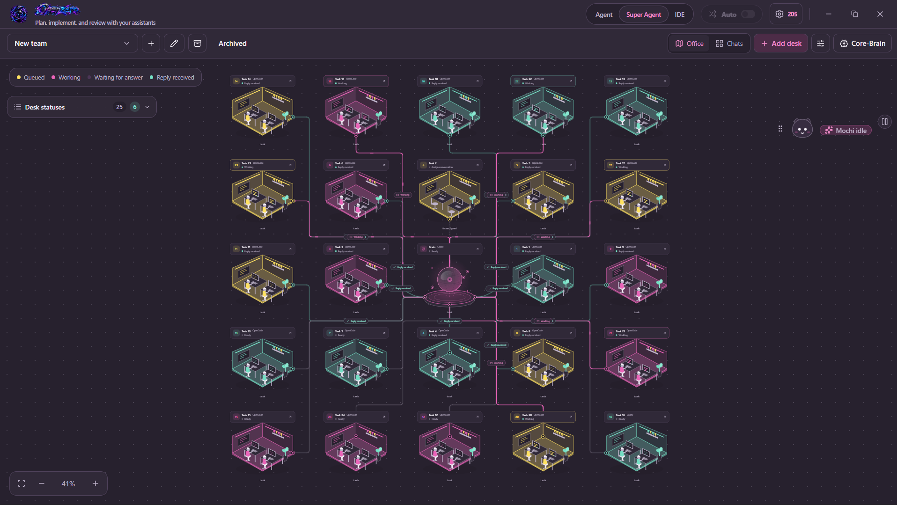
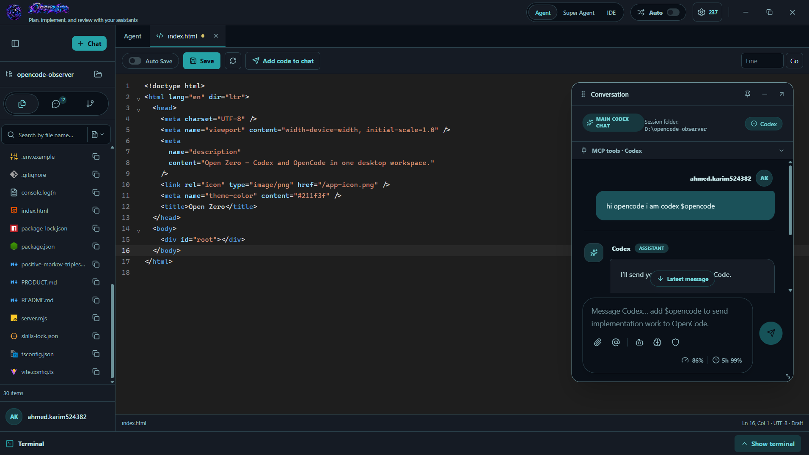
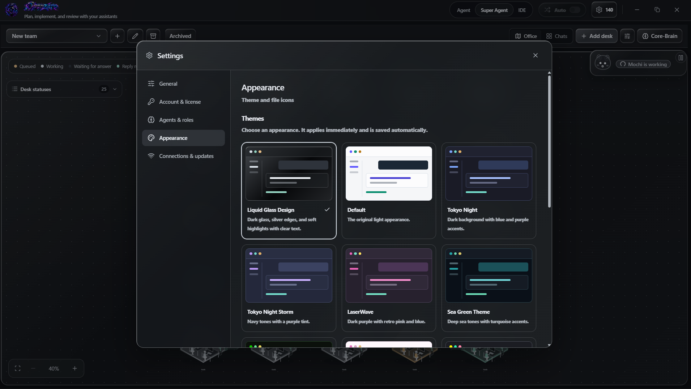

# Open Zero

**مساحة عمل واحدة. وكلاء متعددون. عقل مركزي.**

تطبيق Windows يجمع محادثات الذكاء الاصطناعي، محرر الكود، ملفات المشروع، الترمينال وGit في مكان واحد. اعمل مع وكيل واحد، أو أنشئ فريق **Super Agent** بعقل مركزي ومكاتب مستقلة للتنفيذ والمراجعة والتدخل السريع.

**[تحميل أحدث إصدار](https://github.com/A7me2d/Openzero-Releases/releases/latest)** · **[English](README.md)**

## المميزات

- ربط Codex وOpenCode وCline وClaude، وتكاملات FCC وOllama بحسب الإعدادات والقدرات المتاحة.
- توزيع المهام ومتابعة نتائج المكاتب من خلال العقل ولوحة المهام.
- ذاكرة Core-Brain لحفظ المعرفة والقرارات والدروس بعد مراجعتها واعتمادها.
- موتشي لمتابعة نشاط الفريق وإجراءات المساعدة المدعومة وفق إعداداتك.
- محرر بتبويبات وحفظ تلقائي وشات عائم بجانب الكود.
- بحث بالاسم وداخل الملفات، وترمينال وإدارة Git.
- ثيمات متعددة وواجهة بالعربية والإنجليزية.

## التثبيت

1. افتح صفحة أحدث إصدار.
2. حمّل `Open-Zero-Setup-<version>.exe` من **Assets** وشغّل المثبّت.
3. افتح التطبيق وفعّله بمفتاح صالح.
4. من **الإعدادات ← الاتصال والتحديثات** فعّل المزود المطلوب وتأكد من تثبيت أداته وتسجيل الدخول إليها.
5. اختر مجلد مشروعك وابدأ محادثة أو أنشئ فريقًا.

ملفات `latest.yml` و`.blockmap` للتحديث التلقائي وليست للتثبيت. أرشيف **Source code** يخص هذا الريبو، وليس كود التطبيق.

## المتطلبات

النسخة مخصصة لـ **Windows x64** وتتطلب مفتاح تفعيل. حسابات المزودين وصلاحيات الموديلات وتكلفتها منفصلة عن تفعيل Open Zero. لا تحتاج Node.js أو npm لتشغيل التطبيق المثبّت نفسه؛ أدوات المزودين ومشروعاتك قد تحتاج متطلبات إضافية.

يمكن فحص التحديث من **الاتصال والتحديثات** أو تنزيل المثبّت الأخير يدويًا. دعم الإضافات انتقائي؛ ليست كل إضافة VS Code قابلة للتشغيل داخل Open Zero. راجع التغييرات واختبر مشروعك قبل اعتماد النتائج.

*الصور من نسخة تطوير سابقة؛ قد تختلف بعض تفاصيل الواجهة في الإصدارات الأحدث.*

## المساعدة

[افتح Issue](https://github.com/A7me2d/Openzero-Releases/issues/new) موضحًا الإصدار والمزود وخطوات تكرار المشكلة، دون إرسال مفاتيح أو توكنات أو بيانات مشروع خاصة.

هذا الريبو للتنزيلات والتوثيق العام، ولا يمنح ترخيصًا مفتوح المصدر للتطبيق أو هويته البصرية.
